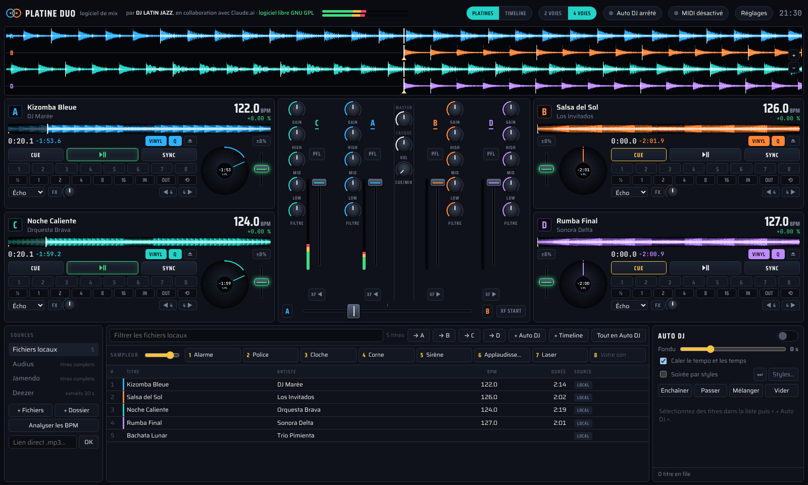
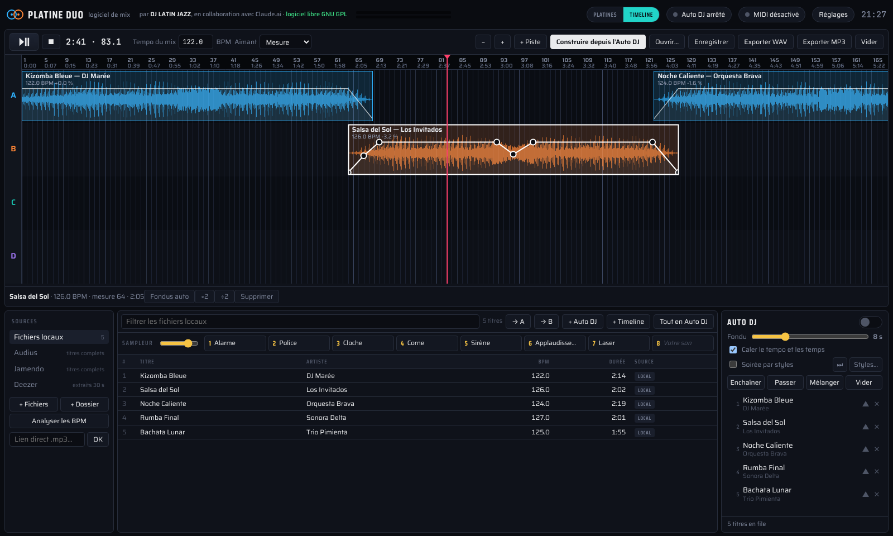
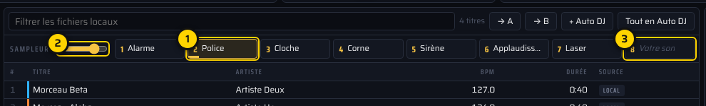
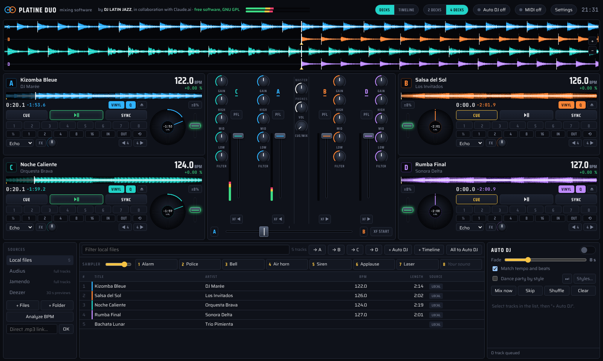
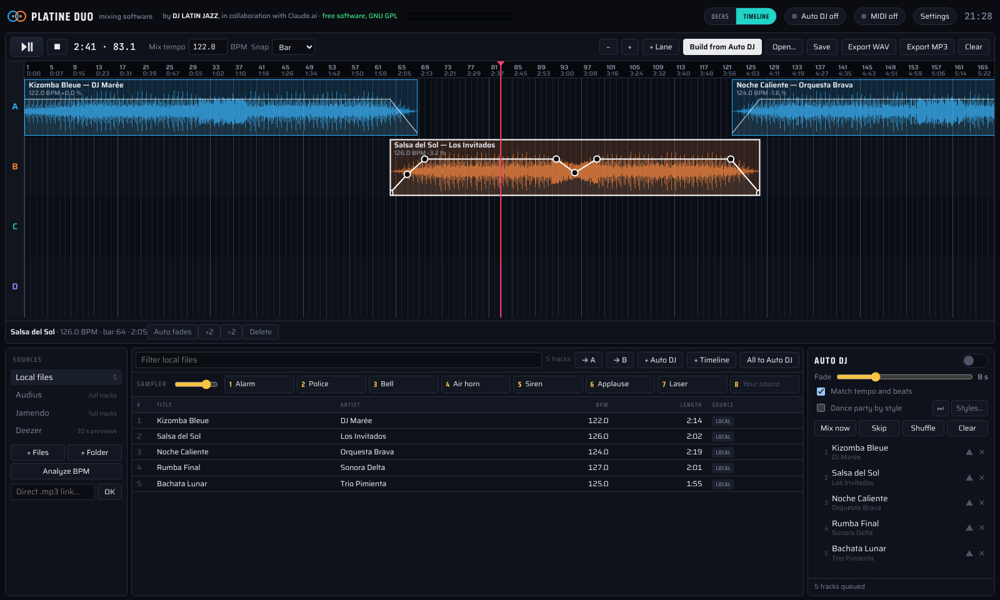

# Platine DUO

**Logiciel de mix DJ libre — Free DJ mixing software**
Windows · Mac · Linux · Android · iPhone · navigateur (Chrome, Edge, Opera tout navigateur gérant le MIDI)



**Site : https://deltapassion.github.io/Platine-Duo/** · essai en ligne : https://deltapassion.github.io/Platine-Duo/app/

Créé par **Jacques Branas, alias DJ LATIN JAZZ**, en collaboration avec Claude.ai (Anthropic) en réponse au fait que ma licence VirtualDJ ne peux pas fonctionner (je suis le nouveau propriétaire d'un controleur Gemini GMX).
Logiciel libre sous licence **GNU GPL version 2 ou ultérieure**. Contact : deltapassion@gmx.com

*English below.*

**Free DJ mixing software**
Windows · Mac · Linux · Android · iPhone · Browser (Chrome, Edge, Opera, or any browser that supports MIDI)

**Website: https://deltapassion.github.io/Platine-Duo/** · Try it online: https://deltapassion.github.io/Platine-Duo/app/

Created by **Jacques Branas, alias DJ LATIN JAZZ**, in collaboration with Claude.ai (Anthropic), as a solution to an issue where my VirtualDJ license would not work (I am the new owner of a Gemini GMX controller).
Free software licensed under the **GNU GPL version 2 or later**. Contact: deltapassion@gmx.com


---

## Ce que fait Platine DUO

- **2 ou 4 platines** au choix (bouton « 2 VOIES / 4 VOIES » en haut de l'écran), avec formes d'onde, BPM, SYNC, 8 repères, boucles, effets (écho, flanger, réverb), jog et pitch.
- **Mode timeline** (bouton « PLATINES / TIMELINE »), à la façon de MixMeister : les titres deviennent des blocs posés sur des pistes, calés sur le tempo du mix, avec une **courbe de volume** à points pour régler la montée et la coupure du son. « Construire depuis l'Auto DJ » enchaîne la file automatiquement ; le mix s'**exporte en WAV ou en MP3**.
- **Table de mixage** jusqu'à 4 voies : gain, égaliseur 3 bandes, filtre, pré-écoute au casque, crossfader avec affectation de chaque voie (côté A, côté B ou hors crossfader), **XF START**.
- **Auto DJ** : le robot enchaîne les titres d'une platine à l'autre en respectant vos faders.
- **Soirée par styles** : l'Auto DJ joue des séries par style de danse à partir de vos dossiers (par exemple 3 salsas, 3 bachatas, 3 kizombas, puis semba, tango…), jusqu'à 8 styles, nombre de titres par série réglable.
- **Sampleur à 8 pads** : alarme, police, cloche, sirène… et vos propres sons.
- **Contrôleurs MIDI, USB HID et Bluetooth MIDI**, reconnus au branchement. Intégrés : Gemini GMX (écrans et compteurs compris), Reloop Beatpad, Hercules Inpulse 200 et 500, Pioneer DDJ-FLX4 et DDJ-400, Reloop Terminal Mix 2/4 (4 platines). Les mappings **Mixxx** s'importent tels quels.
- **Sources** : vos fichiers, Audius et Jamendo (titres complets), Deezer (extraits de 30 s).
- **6 langues** : français, English, español, Deutsch, italiano, português. Thèmes, couleur de fond et contraste réglables.





## Télécharger

Les fichiers sont dans la rubrique **Releases** (à droite sur cette page).

| Système | Fichier | Installation |
| --- | --- | --- |
| Windows 10 / 11 | `Platine-DUO-Setup-2.1.0.exe` | Double-clic. L'installateur propose de retirer l'ancienne version (Platine Duo, Platine Duo 4V) ; vos réglages sont gardés. Si Windows affiche « Windows a protégé votre ordinateur », cliquez **Informations complémentaires › Exécuter quand même** (l'installateur n'est pas signé par un certificat payant). |
| Mac Apple Silicon (M1, M2, M3, M4…) | `Platine-DUO-2.1.0-mac-arm64.zip` | macOS 12 Monterey ou plus récent. Double-clic sur le .zip, puis glissez **Platine DUO** dans le dossier Applications. Premier lancement : voir « Ouvrir sur Mac » plus bas. |
| Mac Intel | `Platine-DUO-2.1.0-mac-x64.zip` | Pareil. Pour savoir quel Mac vous avez : menu Pomme › À propos de ce Mac (« Puce Apple » ou « Processeur Intel »). |
| Ubuntu, Debian, Mint | `platine-duo_2.1.0_amd64.deb` | `sudo apt install ./platine-duo_2.1.0_amd64.deb` (remplace les versions précédentes) |
| Toute distribution Linux (PC 64 bits) | `Platine-DUO-2.1.0-x86_64.AppImage` | `chmod +x Platine-DUO-2.1.0-x86_64.AppImage` puis double-clic. Si rien ne s'ouvre sur Ubuntu 22.04 ou plus récent : `sudo apt install libfuse2` (24.04 : `libfuse2t64`). Pour un contrôleur en USB HID (écrans du GMX), installez une fois les règles d'accès : voir plus bas. |
| Android (tablettes et téléphones) | en ligne : https://deltapassion.github.io/Platine-Duo/app/ | Ouvrir dans Chrome, puis menu ⋮ › « Installer l'application ». Contrôleurs MIDI en USB (câble OTG). Bientôt sur Google Play. |
| iPhone et iPad | en ligne : https://deltapassion.github.io/Platine-Duo/app/ | Ouvrir dans Safari, bouton Partager › « Sur l'écran d'accueil ». Au doigt : Apple ne permet pas encore les contrôleurs MIDI dans les navigateurs. |
| Navigateur | `platine-duo.html` | Ouvrir dans Chrome, Edge ou Opera sur ordinateur. |

**Notice illustrée en 6 langues** : [docs/notice-platine-duo.html](docs/notice-platine-duo.html) (téléchargez le fichier et ouvrez-le dans votre navigateur ; notice de la 1.1.0 : [docs/notice-platine-duo-1.1.0.html](docs/notice-platine-duo-1.1.0.html)).

**Avant de lancer Platine DUO, fermez Mixxx** : un contrôleur ne peut servir qu'à un logiciel à la fois.

### Ouvrir sur Mac

Platine Duo n'est pas signé par un certificat Apple payant : au premier lancement, macOS refuse de l'ouvrir. Une seule fois :

1. Double-cliquez sur **Platine DUO** dans Applications ; macOS affiche un message d'avertissement, cliquez **OK** (ou **Terminé**).
2. Ouvrez **Réglages Système › Confidentialité et sécurité**, descendez jusqu'au message sur Platine DUO et cliquez **Ouvrir quand même**, puis confirmez avec votre mot de passe.

Ensuite il s'ouvre normalement. Si macOS indique que l'application « est endommagée », tapez dans le Terminal : `xattr -dr com.apple.quarantine "/Applications/Platine DUO.app"`.

Au premier lancement, macOS peut demander l'accès au micro : Platine Duo s'en sert seulement pour afficher le nom de vos cartes son, rien n'est enregistré. Pour le casque du GMX : **Configuration audio et MIDI** › GMX › **Configurer les haut-parleurs** › Quadriphonique. Sur Mac, `Cmd` remplace `Ctrl` dans les raccourcis.

### Règles d'accès USB pour Linux (AppImage ou sources)

Le paquet `.deb` les installe tout seul. Avec l'AppImage ou depuis les sources :

```bash
sudo cp build/linux/69-platine-duo-usb.rules /etc/udev/rules.d/
sudo udevadm control --reload-rules
```

Puis débranchez et rebranchez le contrôleur.

## Compiler depuis les sources

Il faut Node.js 20 ou plus récent.

```bash
npm install                # Electron et les outils de construction
npm start                  # lancer sans installer
npm run dist:linux         # paquet .deb      → dist/platine-duo_2.1.0_amd64.deb
npm run dist:appimage      # AppImage         → dist/
npm run dist:win           # installateur Windows (NSIS requis : sudo apt install nsis)
npm run dist:mac           # Mac arm64 et x64 → dist/*.zip (sur Linux : rcodesign requis)
```

| Élément | Rôle |
| --- | --- |
| `app/index.html` | le logiciel complet (interface, moteur audio, mappings, traductions) ; fonctionne aussi seul dans un navigateur |
| `main.js`, `preload.js` | l'application de bureau (Electron) et son pont sécurisé avec la page |
| `installer.nsi`, `afterPack.js` | l'installateur Windows et l'icône de l'exécutable |
| `build/` | icônes, règles USB pour Linux, scripts du paquet .deb |
| `mappings/` | mappings d'origine (Gemini GMX v2.1, projet Mixxx) |

## Nouveautés de la version 2.1.0 (Platine DUO)

- Le logiciel s'appelle désormais **Platine DUO** (sans « 4V » : le mode 4 voies est toujours là).
- **Mode timeline** façon MixMeister : bouton PLATINES / TIMELINE, pistes A à H, blocs calés sur le tempo du mix, aimant (temps, mesure, 4 mesures), découpe des débuts et des fins.
- **Courbes de volume** à points pour la montée, les baisses et la coupure du son ; fondus automatiques au départ.
- **Construire depuis l'Auto DJ** (ou depuis la soirée par styles) : les titres sont placés et enchaînés tout seuls.
- **Export du mix en WAV et en MP3** (320 kbit/s), plus rapide que la lecture ; projet enregistrable (.pdmix).
- Raccourcis en mode timeline : `Espace` lecture / pause, `Suppr` supprime le bloc choisi, `Ctrl` + molette pour zoomer.
- Vos réglages, mappings, repères et sons du sampleur sont conservés.

## Version 2.0.0 (Platine Duo 4V)

- Mode **4 voies** : platines C et D, table de mixage à 4 voies avec la lettre de chaque voie, affectation de chaque voie au crossfader. XF START lance la platine choisie de chaque côté du crossfader ; l'Auto DJ utilise A et B.
- **Soirée par styles** pour l'Auto DJ (Réglages › Soirée) : un dossier par style, séries de N titres, rotation des styles, bouton ⏭ pour passer au style suivant.
- Mapping **Reloop Beatpad** intégré, reconnu au branchement.
- **Version Mac** (Apple Silicon et Intel).
- Raccourcis : `Ctrl+Maj+←` / `Ctrl+Maj+→` chargent le titre sélectionné sur C / D.
- Vos réglages, mappings, repères et sons du sampleur de la version 1.1.0 sont conservés.

## Soutenir le projet

Platine Duo est gratuit et le restera. Si vous l'aimez, un petit don aide à le faire vivre : [faire un don sur Ko-fi](https://ko-fi.com/djlatinjazz) (montant libre, par carte ou PayPal). Objectif en cours : un Reloop Terminal Mix 8, pour intégrer son mapping.

## Signaler un problème

Cliquez sur [Signaler un bug](https://github.com/Deltapassion/Platine-Duo/issues/new?template=bug.yml) (onglet **Issues**), ou écrivez à deltapassion@gmx.com. Indiquez votre système, votre contrôleur et ce qui s'est passé.

---

## English

**Free DJ mixing software**
Windows · Mac · Linux · Android · iPhone · Browser (Chrome, Edge, Opera, or any browser that supports MIDI)





- Two or four decks ("2 DECKS / 4 DECKS" switch at the top of the screen) with waveforms, BPM, sync, 8 hot cues, loops, effects, jog and pitch.
- **Timeline mode** ("DECKS / TIMELINE" switch), MixMeister style: tracks become blocks on lanes, locked to the mix tempo, with point-based **volume curves** for fade-ins and cuts. "Build from Auto DJ" chains the queue automatically, and the mix can be **exported to WAV or MP3**.
- Mixer with up to 4 channels: 3-band EQ, filter, headphone cue, crossfader with per-channel assignment, and **XF START** (crossfader starts the deck).
- **Auto DJ** robot that alternates decks and respects your channel faders, with a **party-by-style** mode: sets of N tracks per dance style taken from your folders (salsa, bachata, kizomba, semba, tango…).
- **8-pad sampler** with built-in sounds and your own files.
- **MIDI, USB HID and Bluetooth MIDI controllers**, detected when plugged in: Gemini GMX (with its screens and counters), Reloop Beatpad, Hercules Inpulse 200/500, Pioneer DDJ-FLX4/DDJ-400, Reloop Terminal Mix 2/4 (4 decks). **Mixxx mappings** can be imported as they are.
- Sources: local files, Audius and Jamendo (full tracks), Deezer (30-second previews).
- Interface in 6 languages, with themes, background colour and contrast settings.

**Download** the Windows installer, the Mac `.zip` (Apple Silicon `arm64` or Intel `x64`, macOS 12 Monterey or later), the `.deb` package, the AppImage or the HTML file from **Releases**. On a Mac, the app is not signed with a paid Apple certificate: on first launch, go to System Settings › Privacy & Security › **Open Anyway**. Illustrated manual in 6 languages: `docs/notice-platine-duo.html`. Close Mixxx before starting Platine Duo. To build from source, see the commands above (`npm install`, `npm start`, `npm run dist:linux`).

Free forever; if you like it, you can [support the project on Ko-fi](https://ko-fi.com/djlatinjazz).

Created by **Jacques Branas, alias DJ LATIN JAZZ**, in collaboration with Claude.ai (Anthropic), as a solution to an issue where my VirtualDJ license would not work (I am the new owner of a Gemini GMX controller).
Free software licensed under the **GNU GPL version 2 or later**. Contact: deltapassion@gmx.com

---

## Sécurité / Security

- La page tourne dans un bac à sable, sans accès au système, isolée du reste de l'application.
- Aucun script ne peut être chargé depuis Internet (politique de contenu CSP).
- Le MIDI, l'USB et le Bluetooth ne sont autorisés que pour la page du logiciel.
- L'application ne peut lire sur Internet, pour la page, que les adresses de Deezer (liste fermée).
- Electron 44.9.3, avec les verrous de sécurité « fuses » activés (pas de mode Node, pas d'inspection).
- Un mapping Mixxx importé est un programme : n'importez que des mappings de sources sûres (projet Mixxx,
  auteurs connus), comme dans Mixxx.

## Remerciements / Credits

- Mapping Gemini GMX : mapping HID d'origine et décodage du protocole par Miss (projet
  codecat/mixxx-gemini-gmx), version 2.1 par Jacques Branas.
- Mapping Reloop Beatpad : Chloé Avrillon (DJ Chloé), projet Mixxx, GNU GPL v2 ou ultérieure.
- Mappings Hercules Inpulse 200 et 500, Pioneer DDJ-FLX4 et DDJ-400, Reloop Terminal Mix 2/4,
  bibliothèques `common-controller-scripts.js` et `midi-components-0.0.js`, règles udev : projet Mixxx
  (https://mixxx.org), GNU GPL v2 ou ultérieure.
- Polices Saira, Saira Condensed et JetBrains Mono : SIL Open Font License.
- Electron : licence MIT.
- Export MP3 : encodeur LAME (https://lame.sourceforge.io), version JavaScript lamejs (https://github.com/zhuker/lamejs), GNU LGPL.
